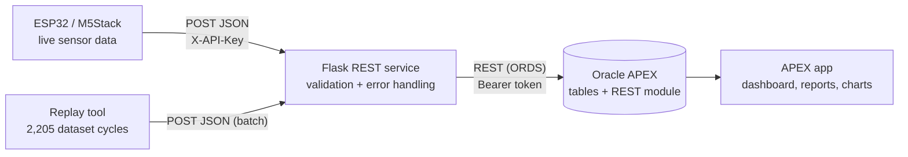

# Low-Code Sensor Platform


A **Flask REST service** that receives JSON sensor data from **M5Stack / ESP32**
devices, **validates** it, and feeds it into an **Oracle APEX** low-code
application for storage, reports and charts.

| | |
|---|---|
| **Sensors** | 17 (pressure, motor power, flow, temperature, vibration, efficiency) |
| **Cycles tested** | 2,205 (all stored, 0 rejected) |
| **Automated tests** | 64 (pytest, run on every push) |
| **Manual tests** | Postman collection with valid and malformed payloads |

> **Idea:** use **low-code** where it is fastest (storage, reports, dashboards,
> user management) and **custom code** where control matters (device-facing API
> and data validation).

---

## Contents

- [How it works](#how-it-works)
- [The 17 sensors](#the-17-sensors)
- [Data source](#data-source)
- [Quick start](#quick-start)
- [API](#api)
- [Validation and errors](#validation-and-errors)
- [Connecting Oracle APEX](#connecting-oracle-apex)
- [ESP32 / M5Stack client](#esp32--m5stack-client)
- [Testing](#testing)
- [Design decisions](#design-decisions)
- [Project structure](#project-structure)
- [What I learned](#what-i-learned)

---

## How it works



1. **Collect.** Devices (or the replay tool) send one JSON message per cycle.
2. **Validate.** The Flask service checks required fields, data types and value
   ranges. Bad data is rejected with a clear error list.
3. **Store.** Valid cycles are forwarded to Oracle APEX through an ORDS REST module.
4. **Visualise.** APEX shows the data in a dashboard, reports and charts.

Example message:

```json
{
  "device_id": "esp32-rig-01",
  "cycle": 1,
  "timestamp": "2026-11-06T08:00:00Z",
  "readings": { "PS1": 160.4, "TS1": 45.2, "VS1": 0.61, "FS1": 6.8 }
}
```

---

## The 17 sensors

**6 pressure + 1 power + 2 flow + 4 temperature + 1 vibration + 3 virtual = 17**

| Code | Sensor | Unit | Allowed range |
|------|--------|------|---------------|
| PS1–PS6 | Pressure 1–6 | bar | 0 – 200 |
| EPS1 | Motor power | W | 0 – 3,500 |
| FS1–FS2 | Volume flow 1–2 | l/min | 0 – 30 |
| TS1–TS4 | Temperature 1–4 | °C | -20 – 100 |
| VS1 | Vibration | mm/s | 0 – 5 |
| CE | Cooling efficiency (virtual) | % | 0 – 100 |
| CP | Cooling power (virtual) | kW | 0 – 10 |
| SE | System efficiency (virtual) | % | 0 – 100 |

*Virtual sensors are calculated from other measurements, not measured directly.*
The full catalog is served by `GET /api/sensors` and defined in
[`app/sensors.py`](app/sensors.py).

---

## Data source

The platform was tested in two ways:

- **Live device data:** an ESP32 / M5Stack sends real readings over Wi-Fi to
  test the device connection end to end.
- **Dataset replay:** the **Condition Monitoring of Hydraulic Systems** dataset
  (available on [Kaggle](https://www.kaggle.com/datasets/jjacostupa/condition-monitoring-of-hydraulic-systems),
  originally from the [UCI Machine Learning Repository](https://archive.ics.uci.edu/dataset/447/condition+monitoring+of+hydraulic+systems),
  recorded by ZeMA gGmbH, Saarbrücken) provides **17 sensors across 2,205 load
  cycles** from a real hydraulic test rig.

Each sensor in the dataset records many samples per 60-second cycle (up to
100 Hz). [`tools/replay_cycles.py`](tools/replay_cycles.py) reduces each cycle
to its **mean value per sensor**, so one cycle becomes one JSON message, and
sends them through the same API the devices use.

The dataset files are not included in this repository. Download them and pass
the folder with `--data-dir`.

---

## Quick start

```bash
git clone https://github.com/Jatin1Mathur/lowcode-sensor-platform.git
cd lowcode-sensor-platform
python -m venv .venv && source .venv/bin/activate
pip install -r requirements-dev.txt
python run.py                       # http://localhost:5000
```

Send one reading:

```bash
curl -X POST http://localhost:5000/api/readings \
  -H "Content-Type: application/json" \
  -d '{"device_id":"esp32-rig-01","cycle":1,"timestamp":"2026-11-06T08:00:00Z",
       "readings":{"PS1":160.4,"TS1":45.2,"VS1":0.61,"FS1":6.8}}'
```

Replay all 2,205 cycles:

```bash
python tools/replay_cycles.py --data-dir ./hydraulic_dataset   # real dataset
python tools/replay_cycles.py --synthetic --cycles 2205        # no download needed
```

```
cycles 1-500: HTTP 201
...
cycles 2001-2205: HTTP 201
Done: 2205 stored, 0 rejected
```

With Docker:

```bash
docker build -t sensor-platform .
docker run -p 5000:5000 --env-file .env.example sensor-platform
```

---

## API

| Method | Path | Description |
|--------|------|-------------|
| GET  | `/api/health` | Service and storage status |
| GET  | `/api/sensors` | The 17 sensors with unit and allowed range |
| POST | `/api/readings` | Store one cycle |
| POST | `/api/readings/batch` | Store up to 500 cycles at once |
| GET  | `/api/cycles?device_id=&limit=` | List stored cycles |
| GET  | `/api/cycles/{device_id}/{cycle}` | Readings of one cycle |

Write endpoints require the `X-API-Key` header when `DEVICE_API_KEY` is set.

---

## Validation and errors

### Payload rules

| Field | Rule |
|-------|------|
| `device_id` | required, non-empty string, max 64 characters |
| `cycle` | required, integer ≥ 1 |
| `timestamp` | required, ISO 8601 with time zone |
| `readings` | required, sensor code → number; known codes only; finite; inside the sensor's range |

### Status codes

| Code | Meaning | Device should |
|------|---------|---------------|
| **201** | Stored | continue |
| **207** | Batch partly stored (per-item results in body) | fix the rejected items |
| **400** | Invalid JSON or validation failed | fix the payload, **don't retry** |
| **401** | Missing or wrong API key | check configuration |
| **404** | Cycle not found | – |
| **409** | Cycle already stored | treat as done (safe retries) |
| **413** | Batch too large | send smaller batches |
| **415** | Not JSON | send `Content-Type: application/json` |
| **502** | Oracle APEX not reachable | **retry later** |
| **503** | Health check: storage down | – |

### Error format

Every error has the same shape, and **all problems are listed at once**:

```json
{
  "error": {
    "code": "validation_failed",
    "message": "Payload validation failed",
    "details": [
      {"field": "timestamp", "issue": "is required"},
      {"field": "cycle", "issue": "must be an integer"},
      {"field": "readings.PS1", "issue": "out of range [0, 200] bar"},
      {"field": "readings.XX9", "issue": "unknown sensor code"}
    ]
  }
}
```

---

## Connecting Oracle APEX

1. Run [`apex/schema.sql`](apex/schema.sql) and [`apex/ords_module.sql`](apex/ords_module.sql)
   in your APEX workspace (SQL Workshop → SQL Scripts).
2. Protect the `sensor` REST module with an OAuth client (client credentials).
3. Configure the service:
   ```
   STORAGE_BACKEND=apex
   APEX_ORDS_BASE_URL=https://<host>/ords/<schema>/sensor
   APEX_ORDS_TOKEN=<token>
   ```
4. Build the pages described in [`apex/APEX_APP.md`](apex/APEX_APP.md):
   dashboard with sensor chart, cycles report with drill-down, cycle detail,
   and an admin grid for sensor ranges.

**Database model:** `sensor` (catalog) → `sensor_cycle` (one row per device and
cycle, unique) → `sensor_reading` (one row per sensor value), plus the view
`sensor_reading_v` for reports and charts.

---

## ESP32 / M5Stack client

[`firmware/esp32_sensor_client`](firmware/esp32_sensor_client/esp32_sensor_client.ino)
(Arduino, ArduinoJson):

- connects to Wi-Fi and gets UTC time via NTP
- builds one JSON message per cycle and posts it with the API key
- **does not retry 4xx** (the payload is wrong), **retries 5xx and network errors**
  with a growing delay, and treats **409** as already stored

Sensor reads are in `readSensor()`; adapt it to the connected sensors.

---

## Testing

```bash
pytest -q          # 64 passed
```

| Area | What is tested |
|------|----------------|
| Validation | missing fields, wrong types, booleans, NaN / Infinity, range limits and boundaries, unknown sensors, all errors reported together |
| API | every endpoint and status code, API key, invalid JSON, duplicates, batch (201 / 207 / 400 / 413) |
| APEX client | request format, token, URL encoding, 409 / 500 / timeout handling (with a fake ORDS session) |

GitHub Actions runs the tests on every push. For manual tests, import
[`postman/lowcode-sensor-platform.postman_collection.json`](postman/lowcode-sensor-platform.postman_collection.json).

---

## Design decisions

- **Validate at the edge.** Bad data is cheapest to stop before it reaches the
  database, and the device learns exactly what was wrong.
- **Clear 4xx vs 5xx.** Client errors are not retried, server errors are. This
  keeps devices from flooding the API with payloads that will never succeed.
- **Idempotent writes.** `(device_id, cycle)` is unique, so retries never create
  duplicates.
- **Repository pattern.** Routes don't know whether data goes to memory or
  Oracle APEX, so the APEX connection is testable without a real database.
- **Low-code where it fits.** Reports, charts and admin screens are built in
  APEX in minutes; custom code only does what APEX can't do well.

---

## Project structure

```
app/
  __init__.py        app factory, chooses the storage backend
  config.py          settings from environment variables
  sensors.py         the 17 sensors (unit, min, max)
  validation.py      payload validation
  repository.py      in-memory storage + Oracle APEX (ORDS) client
  routes.py          REST endpoints
  errors.py          consistent JSON error format
apex/                Oracle tables, ORDS REST module, APEX page plan
firmware/            ESP32 / M5Stack Arduino client
tools/               replay tool for the 2,205 dataset cycles
postman/             Postman collection
tests/               pytest suite (64 tests)
```

**Tech stack:** Python, Flask, Requests, Oracle APEX, ORDS, PL/SQL,
ESP32 / M5Stack (Arduino, ArduinoJson), pytest, Postman, Docker, gunicorn,
GitHub Actions.

---

## What I learned

- How **low-code and custom code complement each other**: APEX delivered
  storage, reports and charts quickly, while Flask gave full control over
  validation and error handling.
- How to design a **device-friendly REST API**: clear status codes, one error
  format, and safe retries.
- How to **test integrations without the real system**, by putting the APEX
  connection behind a repository and testing it with a fake session.

---

## Author

**Jatin Mathur** · M.Sc. Software Engineering for Industrial Applications, Hof University
[LinkedIn](https://linkedin.com/in/jatin-mathur-b04b122b) · [GitHub](https://github.com/Jatin1Mathur)

## License

MIT
