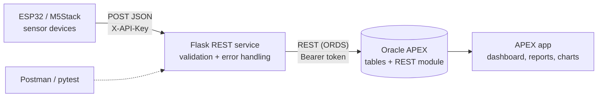

# Low-Code Sensor Platform


A Flask REST service that receives JSON sensor data from **M5Stack / ESP32**
devices, validates it, and feeds it into an **Oracle APEX** low-code
application for storage, reports and charts.

It handles **17 sensors** of a hydraulic test rig (pressure, motor power,
flow, temperature, vibration and efficiency) and was load-tested by replaying
**2,205 load cycles**.

The idea: let the **low-code platform** do what it is good at (data storage,
reports, dashboards, user management) and keep **custom code** for the parts
that need strict control (device-facing API and validation).



## Features

- **Strict validation** of every payload: required fields, data types and value
  ranges per sensor. Every problem is reported at once, so devices and testers
  can fix everything in one go.
- **Consistent JSON errors** with clear HTTP status codes
  (400, 401, 404, 409, 413, 415, 502).
- **Batch endpoint** for devices catching up after being offline, with
  per-item results (`207 Multi-Status` for partial success).
- **Duplicate protection**: the same device cannot store the same cycle twice
  (`409`), so device retries are safe.
- **Pluggable storage**: in-memory for development and tests, Oracle APEX via
  ORDS REST for production.
- **Device authentication** with an API key header (constant-time compare).
- **64 automated tests** (pytest) plus a Postman collection with valid and
  malformed payloads. GitHub Actions runs the tests on every push.
- **Docker** image with gunicorn, running as a non-root user.

## Project structure

```
app/
  __init__.py        app factory, chooses the storage backend
  config.py          settings from environment variables
  sensors.py         catalog of the 17 sensors (unit, min, max)
  validation.py      payload validation
  repository.py      InMemoryRepository + ApexRepository (ORDS client)
  routes.py          REST endpoints
  errors.py          consistent JSON error format
apex/
  schema.sql         Oracle tables, view and sensor catalog
  ords_module.sql    ORDS REST module the service calls
  APEX_APP.md        APEX pages (dashboard, reports, charts)
firmware/
  esp32_sensor_client/esp32_sensor_client.ino
tools/
  replay_cycles.py   replays 2,205 cycles (UCI dataset or synthetic)
postman/             Postman collection
tests/               pytest suite
```

## Quick start

```bash
python -m venv .venv && source .venv/bin/activate
pip install -r requirements-dev.txt
cp .env.example .env          # optional, defaults work for local use
python run.py                 # http://localhost:5000
```

Send a reading:

```bash
curl -X POST http://localhost:5000/api/readings \
  -H "Content-Type: application/json" \
  -d '{
        "device_id": "esp32-rig-01",
        "cycle": 1,
        "timestamp": "2026-11-06T08:00:00Z",
        "readings": {"PS1": 160.4, "TS1": 45.2, "VS1": 0.61, "FS1": 6.8}
      }'
```

Replay 2,205 cycles:

```bash
python tools/replay_cycles.py --synthetic --cycles 2205
# or with the UCI hydraulic dataset files (PS1.txt ... SE.txt):
python tools/replay_cycles.py --data-dir ./uci_hydraulic
```

With Docker:

```bash
docker build -t sensor-platform .
docker run -p 5000:5000 --env-file .env sensor-platform
```

## API

| Method | Path | Description |
|--------|------|-------------|
| GET  | `/api/health` | Service and storage status (`503` if APEX is unreachable) |
| GET  | `/api/sensors` | The 17 sensors with unit and allowed range |
| POST | `/api/readings` | Store one cycle |
| POST | `/api/readings/batch` | Store up to 500 cycles |
| GET  | `/api/cycles?device_id=&limit=` | List stored cycles |
| GET  | `/api/cycles/{device_id}/{cycle}` | Readings of one cycle |

### Payload rules

| Field | Rule |
|-------|------|
| `device_id` | required, non-empty string, max 64 characters |
| `cycle` | required, integer ≥ 1 |
| `timestamp` | required, ISO 8601 with time zone (e.g. `2026-11-06T08:00:00Z`) |
| `readings` | required, object of sensor code → number; known codes only; finite and inside the sensor range |

### Error example

A malformed payload returns `400` with every problem listed:

```json
{
  "error": {
    "code": "validation_failed",
    "message": "Payload validation failed",
    "details": [
      {"field": "timestamp", "issue": "is required"},
      {"field": "cycle", "issue": "must be an integer"},
      {"field": "readings.PS1", "issue": "out of range [0, 200] bar"},
      {"field": "readings.XX9", "issue": "unknown sensor code"}
    ]
  }
}
```

## Connecting Oracle APEX

1. Run `apex/schema.sql` and `apex/ords_module.sql` in your APEX workspace.
2. Protect the `sensor` REST module with an OAuth client (client credentials).
3. Set in `.env`:
   ```
   STORAGE_BACKEND=apex
   APEX_ORDS_BASE_URL=https://<host>/ords/<schema>/sensor
   APEX_ORDS_TOKEN=<token>
   ```
4. Build the pages described in [`apex/APEX_APP.md`](apex/APEX_APP.md).

## Tests

```bash
pytest -q
```

Covers validation (missing fields, wrong types, booleans, NaN/Infinity,
range limits and boundaries, unknown sensors), every endpoint and status code,
batch handling, and the APEX client against a fake ORDS session (timeouts,
409, 500, URL encoding).

Import `postman/lowcode-sensor-platform.postman_collection.json` to test the
running service manually.

## Design decisions

- **Validate before storing.** Bad data is cheapest to fix at the edge, so the
  service rejects it before it reaches the database and tells the device
  exactly why.
- **4xx vs 5xx.** Validation errors (`400`) are not retried by the ESP32
  client, because sending the same payload again would fail again. Server or
  network errors are retried with a growing delay.
- **Repository pattern.** Routes don't know whether data goes to memory or
  Oracle APEX, so the APEX connection can be tested without a real database.
- **Low-code where it fits.** Reports, charts and admin screens are built in
  APEX in minutes; the custom service only does what APEX can't do well.

## License

MIT
